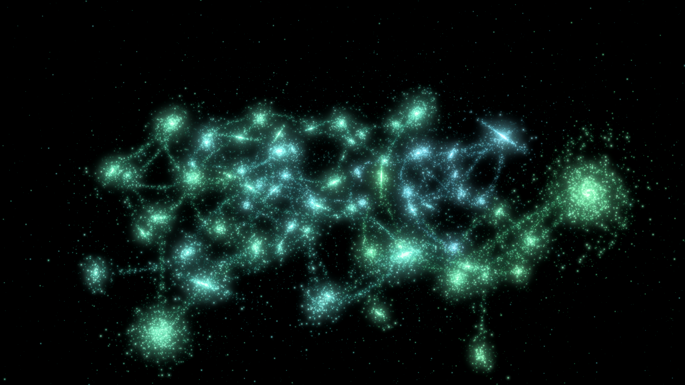

# 2ndbrain — particle field v2

A second-brain visualisation where every glowing particle is one knowledge
unit. Units gather into topic clusters that behave like small galaxies; linked
topics are joined by streaming filaments; unfiled fragments drift in a sparse
outer halo.

## Run it

Open `particle-field-v2.html` in a current Chrome, Edge, Firefox or Safari.
That is all — one file, no build step, no network, no dependencies. It needs
WebGL2.

## Controls

| Input | Action |
|---|---|
| Drag | Orbit |
| Scroll / pinch | Zoom |
| Right-drag, Shift-drag, two-finger drag | Pan |
| Hover | Tooltip for the unit or cluster under the cursor |
| Click / tap | Select a cluster (and the unit you hit); opens the inspector |
| Double-click | Dive into a cluster; on empty space, reset the view |
| `Space` | Pause |
| `R` | Reset view |
| `L` | Toggle labels |
| `H` | Hide all UI |
| `/` | Search clusters |
| `Esc` | Deselect |

Panel sliders: density (5k–150k units), glow, exposure, point size, colour
temperature (emerald → teal → ice), core gravity, web pull, repulsion, link
tension, spiral arms, turbulence, time.

## URL parameters

| Parameter | Effect |
|---|---|
| `?n=60000` | Starting particle count |
| `?seed=12` | Which field to generate |
| `?q=0.7` | Lock render resolution scale (disables adaptive scaling) |
| `?ui=0` | Start with UI hidden |

Default counts: 24k on phones / touch devices, 48k on machines with four or
fewer cores, 80k otherwise.

## Notes

The graph is synthetic demo data. See `AUDIT.md` for the audit of the previous
version, how this one works, measurements, and known limitations.
