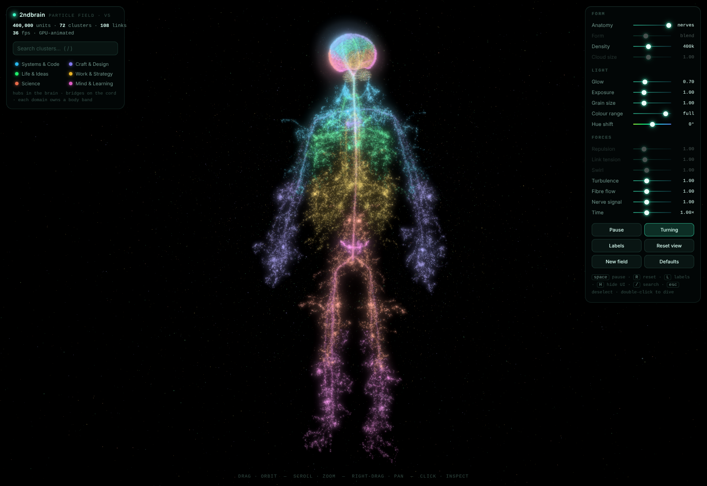

# 2ndbrain — particle field

A second-brain visualisation where every glowing particle is one knowledge
unit. Units gather into topic clusters that behave like small galaxies; linked
topics are joined by streaming filaments; unfiled fragments drift in a sparse
outer halo.

## Dashboard mockup

`second-brain-os.html` is a clickable mockup of the whole system on generated example data (80,000 items). Open it in a browser; the Field needs WebGL2.

- **Now**: open sessions and one card per project (waiting on you, running, stalled, done).
- **Field**: every item is a speck. Pick a **shape** (Neuron, Galaxy, Orbit, Globe, Shell, Nebula, Block) and a **layout** (Whole, Groups, Table); every shape works in every layout. Group by area, project, source, type, status or year.
- **Colour**: palettes (Aurora, Ember, Orchid, Glacier, Starlight, Spectrum), a custom two-colour palette, a colour of your own for any group from the legend, and a Heat mode. The look is remembered in the browser.
- **Record size**: shrink the record from 80,000 items down to 100 to see how it looks when you are starting out. **Play growth** (`G`) adds the items in date order, and `H` hides the interface for recording.
- **Scan**: a slice that sweeps through the picture and lights only the items inside it.
- **Controls**: drag to move, right-drag (or Shift-drag) to rotate, scroll to zoom to the cursor, `R` to stop or start rotation, click a speck to open it. On touch: one finger moves, two fingers zoom and rotate.
- **Timeline**, **Projects**, **Inbox**, **Sources**, and search with `⌘K`.

## Particle field versions

| File | Look | Particles | Motion |
|---|---|---|---|
| `particle-field-v5.html` (current) | Polished nervous system: each domain owns a coloured body band, hubs in the brain, connectors on the cord | 400k default, up to 1M | Computed on the GPU |
| `particle-field-v4.html` | First nervous-system layout, single green palette | 400k default, up to 1M | Computed on the GPU |
| `particle-field-v3.html` | One dense, matte, sculpted dust mass | 400k default, up to 1M | Computed on the GPU |
| `particle-field-v2.html` | Bright bloomed web of small galaxies | 80k default, up to 150k | CPU simulation in a worker |

## Run it

Open either file in a current Chrome, Edge, Firefox or Safari. That is all —
one file each, no build step, no network, no dependencies. They need WebGL2.

## Controls

| Input | Action |
|---|---|
| Drag | Orbit |
| Scroll / pinch | Zoom |
| Right-drag, Shift-drag, two-finger drag | Pan |
| Hover | Tooltip for the unit or cluster under the cursor |
| Click / tap | Select a cluster (and the unit you hit); opens the inspector |
| Double-click | Dive into a cluster; on empty space, reset the view |
| `Space` | Pause |
| `R` | Reset view |
| `L` | Toggle labels |
| `H` | Hide all UI |
| `/` | Search clusters |
| `Esc` | Deselect |

v5 adds **Colour range** (mono green ↔ one hue per domain), **Hue shift**,
**Nerve signal**, and a domain legend in the header: click a chip to isolate
that domain. Hover now works along the nerves themselves.

v4 adds an **Anatomy** slider (off ↔ nerves) above the v3 sliders; it opens in
the nervous-system layout.

v3 sliders: form (single mass ↔ separated web), density, cloud size, glow,
exposure, grain size, colour temperature (moss → leaf → ice), repulsion, link
tension, swirl, turbulence, strand flow, time. In v3, hover identifies clusters
only; click a cluster to pick the unit under the cursor.

v2 sliders: density, glow, exposure, point size, colour temperature, core
gravity, web pull, repulsion, link tension, spiral arms, turbulence, time.

## URL parameters

| Parameter | Effect |
|---|---|
| `?n=60000` | Starting particle count |
| `?form=0.3` | v3/v4: starting form, 0 (mass) to 1 (web) |
| `?anat=0` | v4/v5: starting anatomy morph, 0 (off) to 1 (nervous system) |
| `?range=0` | v5 only: starting colour range, 0 (mono green) to 1 (full) |
| `?seed=12` | Which field to generate |
| `?q=0.7` | Lock render resolution scale (disables adaptive scaling) |
| `?ui=0` | Start with UI hidden |

Default counts — v3: 120k on phones / touch devices, 250k on machines with
four or fewer cores, 400k otherwise. v2: 24k / 48k / 80k.

## Notes

The graph is synthetic demo data. See `AUDIT.md` for the audit of the original
prototype, how each version works, measurements, and known limitations.
