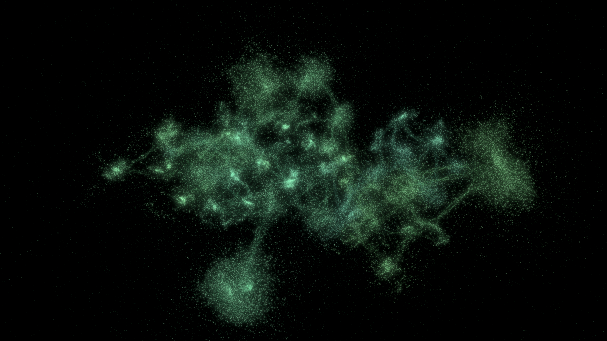

# 2ndbrain — particle field

A second-brain visualisation where every glowing particle is one knowledge
unit. Units gather into topic clusters that behave like small galaxies; linked
topics are joined by streaming filaments; unfiled fragments drift in a sparse
outer halo.

## Two versions

| File | Look | Particles | Motion |
|---|---|---|---|
| `particle-field-v3.html` (current) | One dense, matte, sculpted dust mass | 400k default, up to 1M | Computed on the GPU |
| `particle-field-v2.html` | Bright bloomed web of small galaxies | 80k default, up to 150k | CPU simulation in a worker |

## Run it

Open either file in a current Chrome, Edge, Firefox or Safari. That is all —
one file each, no build step, no network, no dependencies. They need WebGL2.

## Controls

| Input | Action |
|---|---|
| Drag | Orbit |
| Scroll / pinch | Zoom |
| Right-drag, Shift-drag, two-finger drag | Pan |
| Hover | Tooltip for the unit or cluster under the cursor |
| Click / tap | Select a cluster (and the unit you hit); opens the inspector |
| Double-click | Dive into a cluster; on empty space, reset the view |
| `Space` | Pause |
| `R` | Reset view |
| `L` | Toggle labels |
| `H` | Hide all UI |
| `/` | Search clusters |
| `Esc` | Deselect |

v3 sliders: form (single mass ↔ separated web), density, cloud size, glow,
exposure, grain size, colour temperature (moss → leaf → ice), repulsion, link
tension, swirl, turbulence, strand flow, time. In v3, hover identifies clusters
only; click a cluster to pick the unit under the cursor.

v2 sliders: density, glow, exposure, point size, colour temperature, core
gravity, web pull, repulsion, link tension, spiral arms, turbulence, time.

## URL parameters

| Parameter | Effect |
|---|---|
| `?n=60000` | Starting particle count |
| `?form=0.3` | v3 only: starting form, 0 (mass) to 1 (web) |
| `?seed=12` | Which field to generate |
| `?q=0.7` | Lock render resolution scale (disables adaptive scaling) |
| `?ui=0` | Start with UI hidden |

Default counts — v3: 120k on phones / touch devices, 250k on machines with
four or fewer cores, 400k otherwise. v2: 24k / 48k / 80k.

## Notes

The graph is synthetic demo data. See `AUDIT.md` for the audit of the original
prototype, how each version works, measurements, and known limitations.
